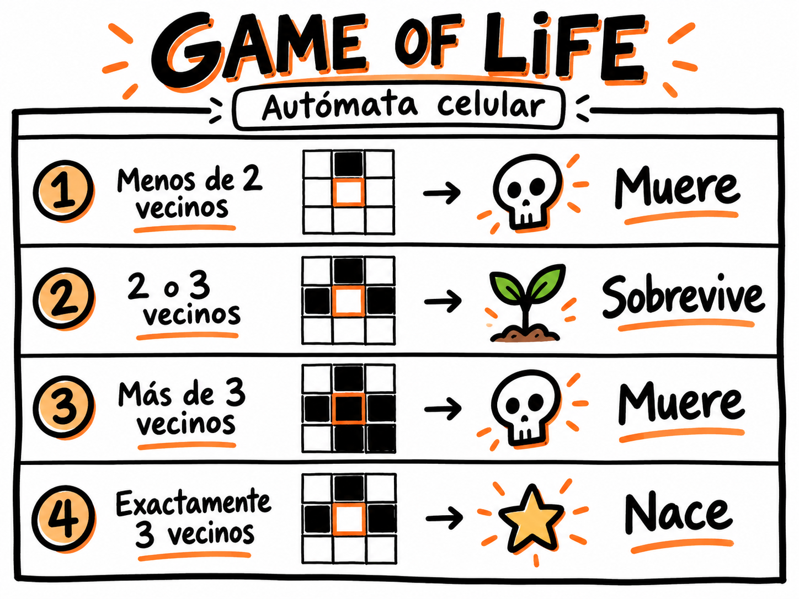
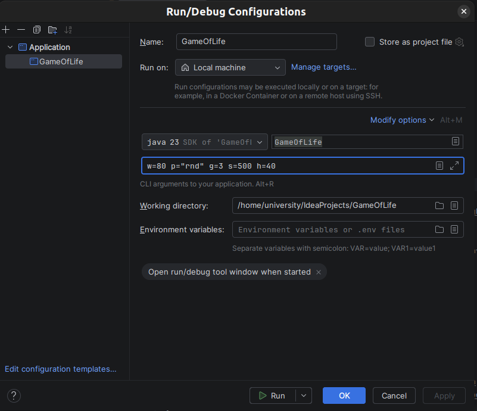
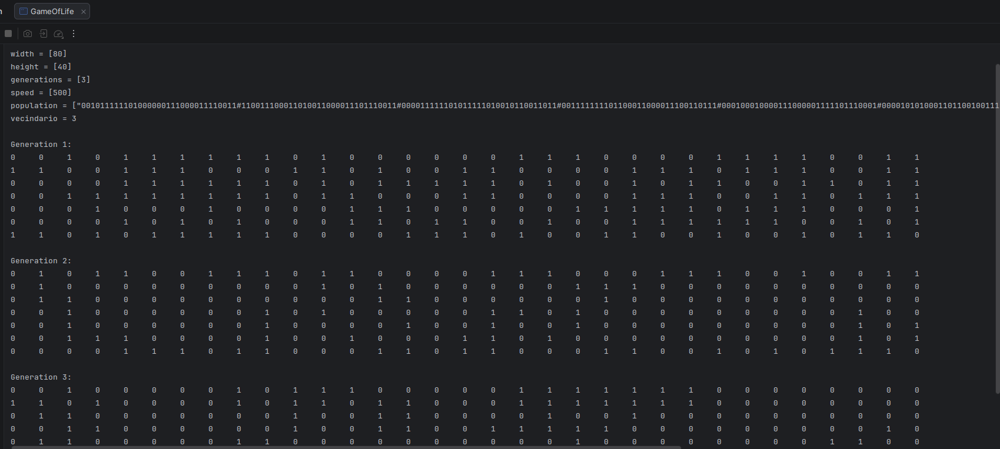

# Game of Life
### Autómata celular en Java

> Proyecto académico desarrollado para la materia de **Programación Procedural**.



---

## Descripción

Este proyecto consiste en una implementación del clásico **Conway’s Game of Life**, un **autómata celular** en el que una población de células evoluciona generación tras generación de acuerdo con reglas.

La simulación fue desarrollada en **Java** y permite configurar distintos parámetros mediante **argumentos de línea de comandos**, como el tamaño del tablero, la velocidad, el número de generaciones, la población inicial y el tipo de vecindario.

---

## ¿Qué es un autómata celular?

Un **autómata celular** es un modelo matemático formado por una cuadrícula de celdas.  
Cada celda puede encontrarse en un estado y cambiar en cada iteración según ciertas reglas.

En este proyecto:

- `1` representa una **célula viva**
- `0` representa una **célula muerta**

En cada generación, el programa analiza los vecinos de cada célula y decide si esta **vive, muere o nace**.

---

## ¿Cómo funciona el juego?

La simulación aplica las reglas clásicas de **Conway’s Game of Life**:

### Regla 1
Si una célula viva tiene **menos de 2 vecinos vivos**, **muere** por soledad.

### Regla 2
Si una célula viva tiene **2 o 3 vecinos vivos**, **sobrevive**.

### Regla 3
Si una célula viva tiene **más de 3 vecinos vivos**, **muere** por sobrepoblación.

### Regla 4
Si una célula muerta tiene **exactamente 3 vecinos vivos**, **nace**.

---

## Características principales

- Implementado en **Java**
- Basado en el modelo de **autómata celular**
- Uso de **programación procedural**
- Configuración por argumentos
- Validación de parámetros
- Soporte para población aleatoria
- Soporte para población personalizada
- Simulación por generaciones
- Distintos tipos de vecindario
- Trabajo con matrices bidimensionales

---

## 🛠Parámetros de ejecución

El programa recibe argumentos con el siguiente formato:

```text
parametro=valor
```

### Ejemplo:

```text
w=80 h=40 g=3 s=500 p=rnd n=3
```

### Parámetros disponibles

| Parámetro | Descripción |
|----------|-------------|
| `w` | Ancho del tablero |
| `h` | Alto del tablero |
| `g` | Número de generaciones |
| `s` | Velocidad entre generaciones |
| `p` | Población inicial |
| `n` | Tipo de vecindario |
| `X` | Generación especial |

---

## Valores usados en la simulación

### Tamaño del tablero
- `w = 10, 20, 40, 80`
- `h = 10, 20, 40`

### Generaciones
- `g >= 0`

### Velocidad
- `s` entre `250` y `1000` milisegundos

### Población inicial
- `p=rnd` para población aleatoria
- o una cadena personalizada con `0`, `1` y `#`

### Vecindario
- `n = 1` a `5`

---

## Población aleatoria

Puedes generar una población aleatoria con:

```text
p=rnd
```

### Ejemplo:

```text
w=80 h=40 g=5 s=500 p=rnd n=3
```

---

## Población personalizada

También puedes definir manualmente la población inicial.

Se usa:

- `1` → célula viva
- `0` → célula muerta
- `#` → salto de fila

### Ejemplo:

```text
p=010#111#010
```

Representación:

```text
0 1 0
1 1 1
0 1 0
```

---

## Tipos de vecindario

El programa permite distintos tipos de vecindario para calcular las reglas de evolución.

### `n=1` — Cruz
Considera vecinos ortogonales:

```text
  X
X O X
  X
```

### `n=2` — Vecindario extendido
Usa una configuración especial de seis posiciones vecinas.

### `n=3` — Moore
Considera los ocho vecinos alrededor de la célula:

```text
X X X
X O X
X X X
```

### `n=4` — Diagonal
Solo considera las diagonales:

```text
X   X
  O
X   X
```

### `n=5` — Personalizado
Utiliza una distribución especial definida en el proyecto.

---

## Ejecución del proyecto

### 1. Clonar el repositorio

```bash
git clone https://github.com/Carla-Mayoli1/GameOfLife.git
```

### 2. Abrir el proyecto en IntelliJ IDEA

Ir a:

```text
File → Open
```

y seleccionar la carpeta del proyecto.

### 3. Configurar argumentos

En IntelliJ IDEA:

```text
Run → Edit Configurations
```

En **Program arguments**, agregar por ejemplo:

```text
w=80 h=40 g=3 s=500 p=rnd n=3
```

### 4. Ejecutar el programa

Ejecutar el archivo principal del proyecto.

---

## Capturas del proyecto

### Configuración de argumentos



### Ejecución de la simulación



---

## Estructura del proyecto

```text
GameOfLife/
│
├── src/
│   └── GameOfLife.java
│
├── docs/
│   └── images/
│       ├── game-of-life-reglas.png
│       ├── configuracion.png
│       └── ejecucion.png
│
├── .gitignore
└── README.md
```

---

## Conceptos aplicados

Durante el desarrollo de este proyecto se aplicaron conceptos de:

- programación procedural
- métodos
- arreglos
- matrices bidimensionales
- condicionales
- ciclos
- validación de datos
- argumentos de línea de comandos
- cadenas de texto
- generación aleatoria

---

## Contexto académico

Este proyecto fue desarrollado como trabajo de la materia de **Programación 1**.

El objetivo fue poner en práctica la lógica de programación a través de una simulación basada en **Conway’s Game of Life**, aplicando estructuras de control, matrices, funciones y validación de entradas.

---

## Autora

**Carla Mayoli**  
GitHub: [Carla-Mayoli1](https://github.com/Carla-Mayoli1)

---